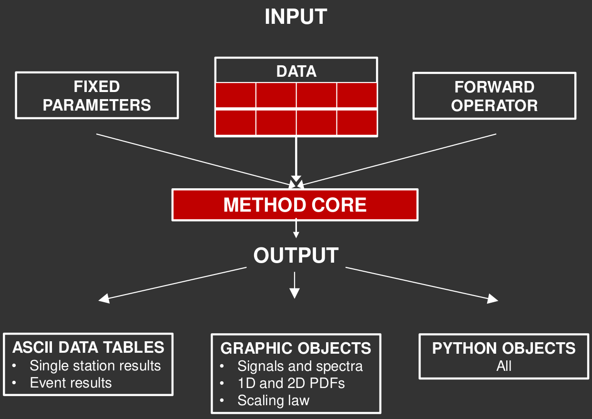
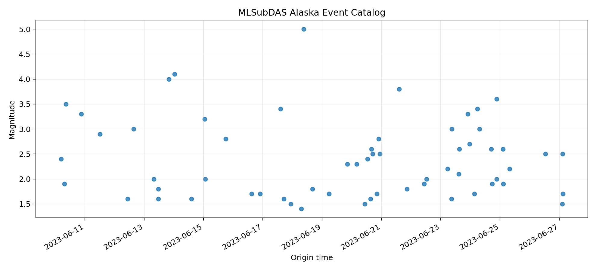
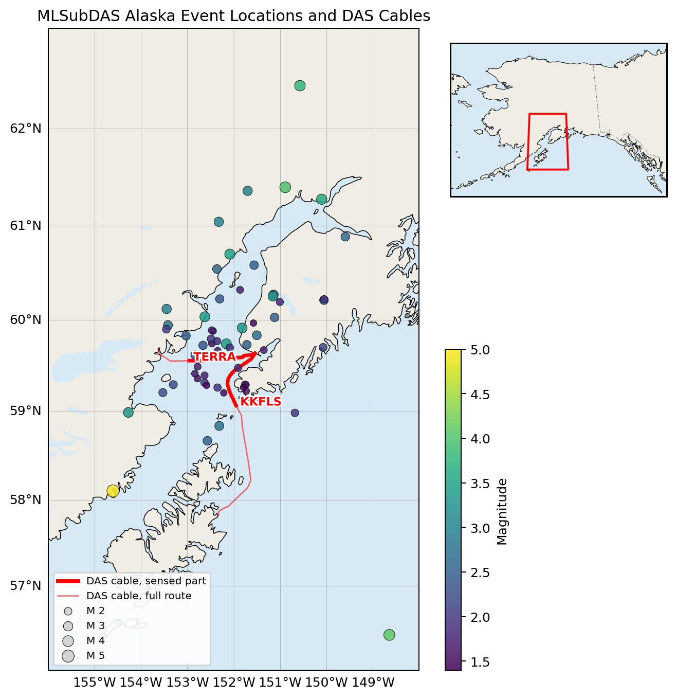
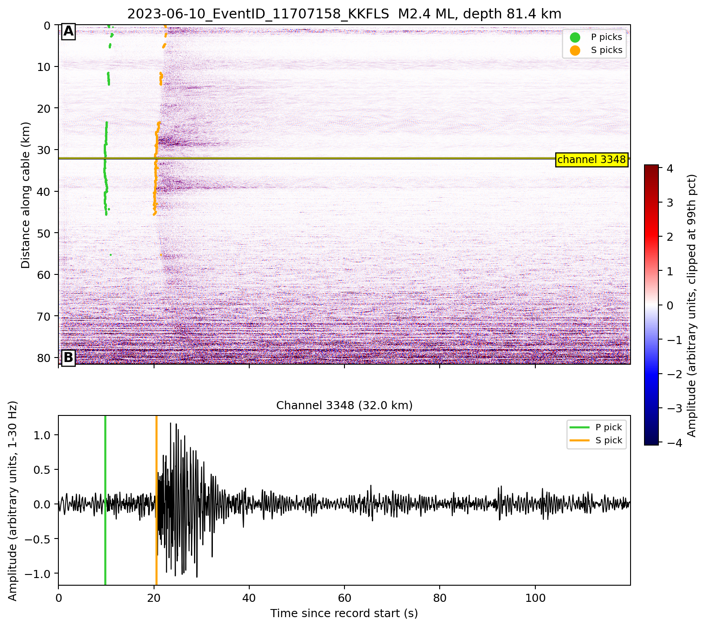
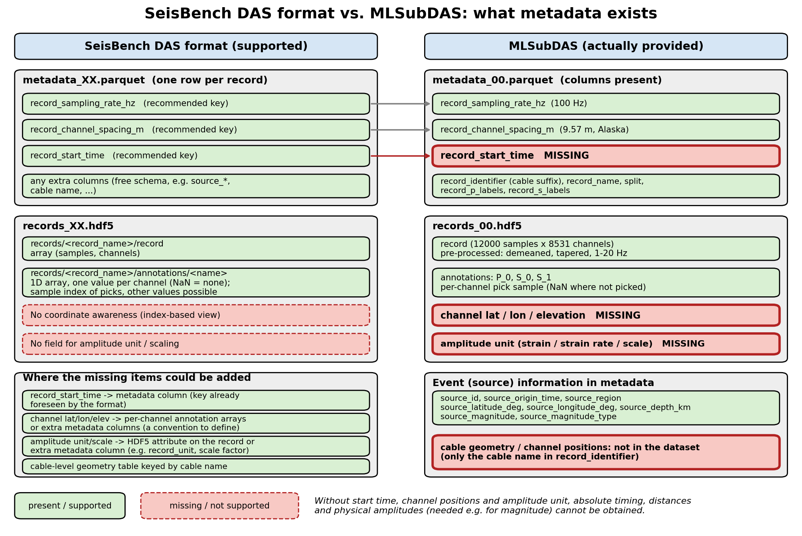
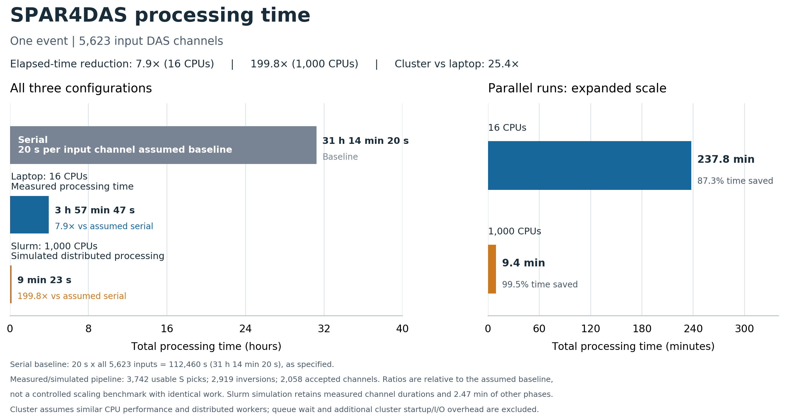
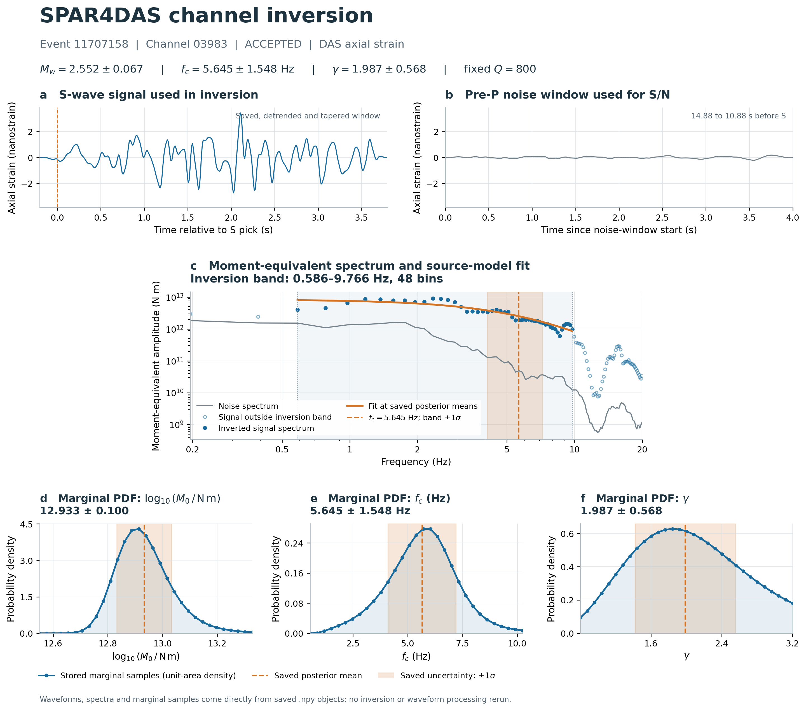
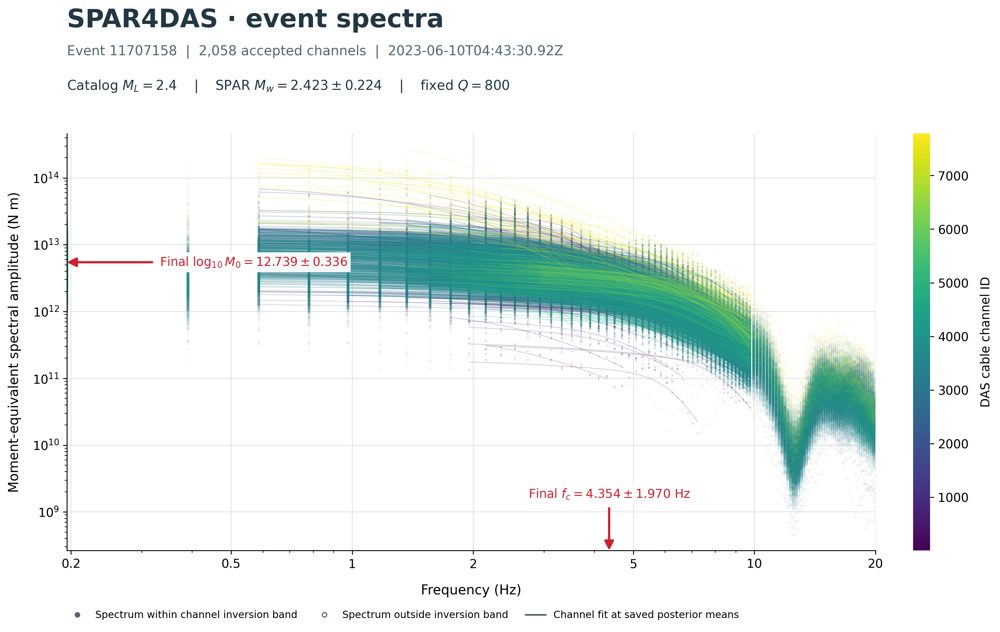
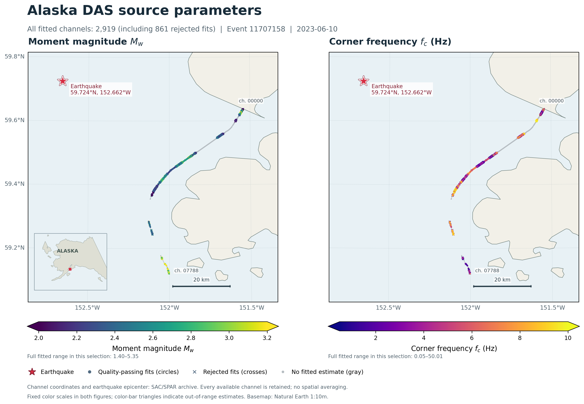

> **This PyPI entry currently contains only development documentation and project specifications for SPAR4DAS (no executable source code is included yet).**

# SPAR4DAS

**Probabilistic earthquake source characterization from distributed acoustic sensing records**

SPAR4DAS adapts the SPAR spectral-inversion method to the axial strain or strain rate measured by distributed acoustic sensing (DAS). It estimates seismic moment **M₀**, corner frequency **fc**, and the high-frequency spectral decay exponent **γ** from individual S-wave channel spectra. Moment magnitude **Mw** and model-dependent source size can be derived from these parameters.

## Availability and future installation

Once the full software is released, the intended installation command is:

```bash
pip install spar4das
```

This current release distributes documentation and figures only: it provides no importable Python module, command-line tool, runtime dependency, or inversion implementation. The scientific results below were obtained with the separate research development version. Configuration instructions, examples, and the supported software environment will accompany the future software release.

**Release-history note:** the earlier `0.0.1a1` alpha included a minimal source-spectrum example. The no-code notice above describes this current documentation-only release; that historical example is not the SPAR4DAS inversion software.

## Method and processing workflow

SPAR4DAS combines the probabilistic inversion of [Supino, Festa and Zollo (2019)](https://doi.org/10.1093/gji/ggz206) with the native-DAS source-radiation formulation of [Strumia et al. (2024)](https://doi.org/10.1029/2023JB027860). Each DAS channel is processed as a single axial component. The implementation demonstrated here uses **S waves with fixed attenuation parameters**.

Input records are converted into one SAC trace per channel, with timing, phase picks, and channel geometry, and read as ObsPy traces. Signal and noise windows are detrended, demeaned, tapered, and transformed into amplitude spectra. Smoothing and signal-to-noise checks determine the usable inversion band.

For positive frequency, the Fourier amplitude of the **time integral of axial strain** is obtained by dividing a strain spectrum by `2πf`, or a strain-rate spectrum by `(2πf)²`. This observable is modeled directly; it is not interpreted as ground displacement or velocity. Its moment-equivalent spectrum follows a generalized [Brune (1970)](https://doi.org/10.1029/JB075i026p04997) model:

```text
A(f) = M₀ / [1 + (f/fc)^γ] × exp[−πf(T/Q + κ)]
```

The observed strain-integral spectrum is divided by:

```text
C_DAS = B_S F / [8π √(ρ_H ρ_R) β_H^(5/2) β_R^(3/2) r]
```

Here `r` is hypocentral distance; `β` and `ρ` are S-wave velocity and density at the source (`H`) and receiver (`R`); `T` is attenuation travel time; `Q` and `κ` describe attenuation; and `B_S` is the average axial S-wave radiation coefficient. The test uses **B_S = 0.2518** and an assumed free-surface factor **F = 2**. Source velocity, shallow receiver velocity, and attenuation travel time have separate roles.

Basin-hopping optimization locates a posterior maximum. Numerical evaluation and integration of a local joint posterior grid then provide marginal means, standard deviations, and parameter trade-offs for log₁₀M₀, fc, and γ. The optimizer trajectory is not used as a posterior sample. In this example, Q and κ are fixed; quality-passing channel estimates are combined by inverse-variance weighting.

[](https://raw.githubusercontent.com/supphy/spar4das-docs/main/figures/figure_1_workflow.png)

*Figure 1 — Processing workflow. The single-channel inversion block runs in a CPU worker pool; the coordinator performs event aggregation and final output. Click any figure to open its full-resolution image.*

## A standardized public DAS test case

This development activity made the first use of a standardized **SeisBench DAS** test set within SPAR4DAS. [SeisBench](https://doi.org/10.1785/0220210324) supplies a common data-access interface; the selected **MLSubDAS** dataset, associated with [Xiao et al. (2026)](https://doi.org/10.1093/gji/ggag061), contains submarine DAS earthquake records from Alaska and Chile, phase annotations, and catalog information.

The inspected first chunk is approximately **41 GB** and contains the Alaska cables **KKFLS** and **TERRA**: **100 records representing 60 distinct earthquakes**, with catalog magnitudes **1.4–5.0**. Each record has **12,000 samples at 100 Hz**, a duration of **120 s**, and up to **8,531 channels** spaced by **9.57 m**.

[](https://raw.githubusercontent.com/supphy/spar4das-docs/main/figures/figure_2_alaska_event_catalog.png)

*Figure 2 — Origin times and catalog magnitudes of the 60 earthquakes in the inspected Alaska data chunk.*

[](https://raw.githubusercontent.com/supphy/spar4das-docs/main/figures/figure_3_alaska_events_and_cables.png)

*Figure 3 — Earthquake epicentres colored by magnitude and DAS cable routes in red. Cable routes come from [Ni et al. (2024)](https://github.com/niyiyu/DAS-reconstruction) and are not supplied with MLSubDAS.*

The end-to-end example is the **10 June 2023 earthquake, EventID 11707158**, recorded by KKFLS. Its catalog origin is **04:43:30.92 UTC**, epicentre **59.724°N, 152.662°W**, and catalog magnitude **ML 2.4**. Of 8,531 original channels, 4,617 have a P pick and 3,742 have an S pick; 5,623 have at least one of these annotations.

[](https://raw.githubusercontent.com/supphy/spar4das-docs/main/figures/figure_4_alaska_record_and_picks.png)

*Figure 4 — Event 11707158: full-cable waveform overview above and one channel below, with P/S picks. Display filtering is 1–30 Hz; amplitudes are arbitrary units and the color scale is clipped at the 99th percentile of absolute amplitude. This display does not restore bandwidth already removed during dataset preparation. A and B mark the first and last sensed channels; time is relative to record start.*

## Metadata findings and recommendations

The standardized interface enabled an end-to-end test, while exposing metadata gaps relevant to source characterization. These findings concern the **examined SeisBench representation and inspected MLSubDAS files**. They do not diminish the value of the dataset for earthquake detection and phase picking.

[](https://raw.githubusercontent.com/supphy/spar4das-docs/main/figures/figure_5_das_metadata_comparison.png)

*Figure 5 — Metadata comparison. Green identifies present information and red identifies missing information. The lower boxes indicate where required timing, channel-position, and amplitude information could be represented.*

**Absolute timing.** The SeisBench DAS writer supports `record_start_time`, but this field is not populated in the inspected MLSubDAS files. Catalog origin time alone does not put picks and waveforms on a common absolute time axis. Comparing S–P times using Vp/Vs = 1.75 and AK135 P- and S-wave travel times places the origin **3.0–4.1 s before record start**, with a median of **3.6 s** and a spread of about **1 s** for this event. This estimated timing supports software testing; the true start time is still required for independent scientific use.

**Channel geometry.** The inspected SeisBench DAS representation is index-based and does not prescribe geographic channel positions; MLSubDAS supplies channel spacing. Test positions were reconstructed by mapping `channel index × 9.57 m` onto the external cable route and estimating seafloor depth from **GEBCO 2020 bathymetry**, at approximately **450 m** resolution. The channel-zero anchor and channel ordering along the route remain unverified; nearshore channels can map onto land. Local fiber orientation is also unavailable.

**Amplitude calibration and processing history.** The inspected files do not supply a recoverable physical amplitude unit and calibration factor. Values are normalized, with standard deviation close to one. Dataset preparation includes mean removal, a 100-sample cosine taper at both ends, and a fourth-order Butterworth band-pass filter between **1 and 20 Hz**. These products support picking, but do not preserve the information needed for independent absolute M₀ or Mw estimation and restrict the usable spectral bandwidth.

The SAC conversion flags estimated timing using `T0_EST` and preserves its uncertainty in a user header. A user-specified start-time strategy is available when timing information is supplied. Each retained channel receives catalog event information, phase picks, and the estimated channel position.

We recommend a community **source-characterization metadata profile**, aligned with the [FDSN DAS draft schema](https://docs.fdsn.org/projects/das-metadata/en/draft/schema.html), that records:

- Mandatory UTC record start time, pick reference, and timing uncertainty.
- Stable channel identifiers, coordinates, elevation/depth, coordinate reference system, cable chainage, and fiber direction.
- The physical observable, amplitude unit, and reversible amplitude scale or calibration.
- Gauge length, acquisition/response information, and complete filtering and normalization history.
- Access to raw or reversibly processed records, with validators that flag missing or estimated metadata.

These are proposed improvements for source-characterization readiness, not changes already adopted by SeisBench.

## Full-event S-wave inversion

The full-cable run used all **5,623 converted input traces**. The **1,881 P-only channels** were not inverted; S-wave jobs were scheduled for the **3,742 channels with S picks**. Theoretical replacement picks were disabled. All input SAC files were verified unchanged during execution, and the run completed without worker errors.

### Test configuration

| Setting | Value used in the demonstration |
| --- | --- |
| Sampling rate | 100 Hz |
| S-wave window | 0.2 s before to 3.8 s after the S pick |
| Noise window | Separate pre-P window |
| Upper configured inversion frequency | 10 Hz |
| Spectral signal/noise amplitude-ratio threshold | 2 |
| Posterior grid | 31 × 31 × 31 |
| Optimization | Basin hopping, up to 20,000 iterations, with configured early stopping |
| Provisional source / receiver S-wave speeds | 4,000 / 1,000 m/s |
| Provisional source / receiver densities | 2,700 / 2,700 kg/m³ |
| Attenuation | Fixed Q = 800; κ = 0; S-pick-based travel time |
| Nominal input scale | Microstrain, with a common additional amplitude multiplier of 10⁻³ |

**Amplitude-scale qualification.** One common amplitude normalization, identical for all channels, was used to obtain an illustrative Mw scale near catalog ML 2.4. Because the original units and calibration cannot be recovered, these nominal strain settings and the resulting absolute moments are a **software demonstration, not an independent magnitude validation**. Geometry and propagation inputs also contain provisional assumptions.

### Channel selection outcome

| Processing stage | Channels | Meaning |
| --- | ---: | --- |
| Input SAC traces | 5,623 | At least one P or S annotation |
| Selected S-wave jobs | 3,742 | An S annotation is available |
| Rejected before spectral inversion | 823 | No acceptable spectral signal/noise band |
| Spectra successfully fitted | 2,919 | Source-parameter solutions obtained |
| Rejected fitted solutions | 861 | 374 corner-frequency and 487 posterior-quality rejections |
| Accepted event contributions | 2,058 | 70.5% of fits; 36.6% of input traces |

### Final event estimate

| Parameter | Weighted event estimate | Between-channel spread, 1σ |
| --- | ---: | ---: |
| log₁₀M₀, with M₀ in N m | 12.739 | 0.336 |
| Mw | 2.423 | 0.224 |
| fc | 4.354 Hz | 1.970 Hz |

The central values retain the inverse-variance weighted event solution; **M₀ ≈ 5.48 × 10¹² N m**. The displayed errors are **unweighted sample standard deviations across accepted channels**, using the N−1 denominator. They describe channel-to-channel spread. They are neither a single-channel posterior uncertainty nor a standard error that treats the densely spaced channels as thousands of independent observations.

## Parallel execution and processing time

SPAR4DAS uses a coordinator and CPU worker processes. Independent channel jobs enter a dynamic queue; workers process and save channel results in isolated working directories. The coordinator collects results in deterministic channel order, computes event estimates, and writes shared summaries. Event/channel-specific random seeds make the computation independent of worker scheduling. Numerical-library threading is limited to one thread per worker to avoid oversubscription.

For the development implementation, `parallel_workers = 0` selects usable logical CPUs automatically, subject to affinity, common cgroup limits, and the number of jobs. A positive count caps CPU use. No GPU is required. The same multiprocessing workflow can run **on one Slurm compute node**, with one task and an appropriate `--cpus-per-task` allocation. It does not span multiple nodes; distributed channel batching and final reduction remain a future deployment step. Batch-level means cannot simply be averaged to reproduce the final weighted event solution.

The measured machine had an **Intel Core i7-1260P**, **12 physical cores / 16 logical CPUs**, and approximately **31 GiB RAM**. Sampled peak proportional memory for the process tree was about **1.88 GiB**. The tested research workflow uses NumPy, SciPy and ObsPy, with Matplotlib for figures; dataset conversion, mapping, and optional profiling use additional packages. It was exercised on Linux; macOS and Windows were not tested in D3.5.

| Configuration | Total elapsed time | Evidence |
| --- | --- | --- |
| Serial reference | 31 h 14 min 20 s | Assumed: 20 s × 5,623 input channels |
| Laptop, 16 logical CPUs | 3 h 57 min 47 s | Measured full-event run |
| 1,000 CPU workers | 9 min 23 s | Scheduling simulation of future distributed execution |

[](https://raw.githubusercontent.com/supphy/spar4das-docs/main/figures/figure_6_processing_time_comparison.png)

*Figure 6 — Processing-time comparison. Gray is an assumed serial reference, blue is the measured laptop result, and orange is a simulation. The right panel expands the parallel-processing time scale.*

The laptop elapsed time was **14,266.54 s**: **14,118.46 s** in channel dispatch and **148.08 s** in other phases. Across 2,919 fitted channels, mean channel wall time was **76.75 s**, including **76.02 s** in the fitter, while workers shared the machine. These are not isolated serial channel timings. The longest scheduled job took **384.89 s**.

The measured run was **7.88 times shorter** than the stipulated serial reference, an **87.3%** reduction in elapsed time. This is **not a controlled equal-workload strong-scaling benchmark**: the serial assumption counts all 5,623 inputs, whereas the measured and simulated pipelines screen the inputs, schedule 3,742 jobs, and fit 2,919 spectra.

The 1,000-worker simulation schedules the measured job durations dynamically in their original order. It gives **414.70 s** for channel processing plus the retained **148.08 s** overhead, totaling **562.78 s**. It assumes comparable CPU performance and excludes queue waiting and additional cross-node startup and filesystem costs. It is not a measured Slurm run or evidence of an implemented multi-node backend.

For operational monitoring, parallelism reduces processing backlog while retaining the probabilistic calculation. Further latency reductions should combine parallelism with quality-aware channel selection or spatial decimation: adjacent channels 9.57 m apart need not all be inverted when their information is redundant. Selection should preserve high-S/N channels, cable bends, and distinct site/azimuth conditions, and be checked against the full-cable reference. **No decimation speed-up was measured in this test.**

## Single-channel inversion and posterior diagnostics

The diagnostic example for **channel 03983** gives **Mw = 2.552 ± 0.067**, **fc = 5.645 ± 1.548 Hz**, and **γ = 1.987 ± 0.568**. These errors are saved marginal posterior standard deviations for that channel. The fit uses **48 spectral bins from 0.586 to 9.766 Hz**.

[](https://raw.githubusercontent.com/supphy/spar4das-docs/main/figures/figure_7_channel_03983_diagnostic.png)

*Figure 7 — Diagnostic example. Top: S-wave and pre-P noise windows. Middle: signal/noise spectra and fitted model, with an fc marker and posterior ±1σ band; the spectrum display ends at 20 Hz. Bottom: saved marginal PDFs for log₁₀M₀, fc and γ. Amplitudes share the common illustrative normalization described above.*

This diagnostic uses the later single-channel rerun with refined posterior-grid settings. The bulk event estimates and timings remain those of the full-cable run. The figure is regenerated offline from saved NumPy objects, without repeating inversion during plotting.

## All accepted spectra

[](https://raw.githubusercontent.com/supphy/spar4das-docs/main/figures/figure_8_accepted_channel_spectra.png)

*Figure 8 — All 2,058 accepted-channel spectra and individual fitted curves, without channel decimation or spectral averaging. Color identifies channel position along the cable. Filled/open points distinguish frequencies inside/outside each channel's inversion band. The display ends at 20 Hz, and curves remain restricted to their fitted bands. Red arrows mark event log₁₀M₀ and fc. Header errors are the 1σ sample spread across accepted channels; the catalog reference is ML 2.4.*

The spectral cloud shows substantial channel-to-channel amplitude variation even for one earthquake. A consistent event estimate does not imply identical sensitivity at every fiber location. The pre-existing 1–20 Hz filtering and the adopted attenuation/site model also limit interpretation of fc and high-frequency-decay variations.

## Spatial distribution of source-parameter estimates

[](https://raw.githubusercontent.com/supphy/spar4das-docs/main/figures/figure_9_source_parameter_maps.png)

*Figure 9 — Mw and fc maps. Circles are accepted fits, crosses are rejected fits, gray channels have no fitted estimate, and the star is the epicentre. All 2,919 fitted solutions are shown; only the 2,058 accepted solutions contribute to the event estimate. Channel coordinates are reconstructed estimates. Color-bar triangles indicate saturation; the basemap is Natural Earth.*

The strongest Mw outliers occur toward both ends of the analyzed cable, especially the high-channel-number end. Of **135 fitted Mw estimates outside the displayed 2.0–3.2 color interval**, **90** occur within the first or last **10% of the input channel-ID range**. Those two end regions contain **371 of 2,919 fitted channels**. This describes a spatial pattern, not an additional quality-rejection rule.

| Parameter | Accepted fits | All fits, including rejected solutions |
| --- | --- | --- |
| Mw range | 1.49–3.78 | 1.40–5.35 |
| fc range | 0.82–9.76 Hz | 0.05–50.01 Hz |

One plausible contribution is the use of a **single averaged axial radiation coefficient**, B_S = 0.2518. The true projection of the event's strain radiation onto the local fiber direction can vary along a curved cable. With other factors held fixed, stronger projected radiation than the adopted average raises the inferred moment, and weaker projection lowers it:

```text
M₀,fitted / M₀,true ≈ B_S,true / B_S,average
ΔMw ≈ (2/3) log₁₀(B_S,true / B_S,average)
```

The map does not uniquely establish this explanation. Coupling and nearshore site conditions, provisional shallow velocity, low-S/N trade-offs, finite bandwidth, and the unverified channel-to-route mapping can also contribute. Spatially varying fc and extreme rejected solutions should not be interpreted as different physical source sizes within this single earthquake. A common amplitude rescaling cannot correct relative directional or site-dependent effects.

Further tests should use verified fiber geometry, focal mechanisms or empirical channel-response corrections, and independent conventional-station spectra.

## Reproducibility and outputs

The archived run preserves input records, executed configuration, processed spectra, posterior objects, text summaries, rejection reasons, and per-channel timing logs. Timestamped output directories, event/channel-specific seeds, isolated worker output, and deterministic aggregation support reproducibility. Serial/parallel consistency and aggregation were checked during implementation; the performance example reported here was run in parallel.

Saved `Results.npy` and `Spectra.npy` objects allow diagnostic figures, combined spectra, and maps to be produced offline. The output includes estimated parameters and uncertainties in Python dictionaries and text files, with optional waveform, spectrum, and PDF plots. Input/data distribution must retain the applicable upstream licenses.

## Main achievements and next steps

- **Standardized DAS testing:** a public SeisBench/MLSubDAS example enabled end-to-end processing and identified timing, geometry, and amplitude-calibration gaps that matter for source characterization.
- **Parallel execution:** channel-level multiprocessing was implemented, exercised on all 16 laptop CPUs, and documented with complete progress and resource records. The 1,000-worker result remains a planning simulation.
- **An inspectable Alaska result:** 5,623 inputs produced 2,919 fitted spectra and 2,058 accepted contributions. Posterior diagnostics, all accepted spectra, and geographic maps show both the event estimate and the along-cable variability.

Independent validation requires calibrated DAS records, verified geometry, conventional-station estimates for multiple events, posterior-grid sensitivity checks, and channel-selection tests. Agreement with catalog ML 2.4 in this demonstration is illustrative because a common amplitude normalization was applied.

`SPAR4DAS` is planned for future public open-source release [under GPL-3.0 / open-source license] following completion of the ongoing scientific validation on calibrated DAS datasets and the public release of the underlying core `SPAR` package. Integration with the open-source `XDAS` framework is also being explored as a possible future distribution option; it is not part of the demonstrated implementation.

## Scientific references and project context

1. Supino, M., Festa, G., and Zollo, A. (2019). *A probabilistic method for the estimation of earthquake source parameters from spectral inversion: application to the 2016–2017 Central Italy seismic sequence.* Geophysical Journal International, 218, 988–1007. [doi:10.1093/gji/ggz206](https://doi.org/10.1093/gji/ggz206).
2. Strumia, C., Trabattoni, A., Supino, M., Baillet, M., Rivet, D., and Festa, G. (2024). *Sensing optical fibers for earthquake source characterization using raw DAS records.* Journal of Geophysical Research: Solid Earth, 129, e2023JB027860. [doi:10.1029/2023JB027860](https://doi.org/10.1029/2023JB027860).
3. Brune, J. N. (1970). *Tectonic stress and the spectra of seismic shear waves from earthquakes.* Journal of Geophysical Research, 75, 4997–5009. [doi:10.1029/JB075i026p04997](https://doi.org/10.1029/JB075i026p04997).
4. Woollam, J., et al. (2022). *SeisBench—A toolbox for machine learning in seismology.* Seismological Research Letters, 93, 1695–1709. [doi:10.1785/0220210324](https://doi.org/10.1785/0220210324).
5. Xiao, H., et al. (2026). *DeepSubDAS: An Earthquake Phase Picker from Submarine Distributed Acoustic Sensing Data.* Geophysical Journal International, 245, ggag061. [doi:10.1093/gji/ggag061](https://doi.org/10.1093/gji/ggag061).
6. Ni, Y., et al. (2024). *DAS-reconstruction: cable geometry data.* [Source repository](https://github.com/niyiyu/DAS-reconstruction).
7. FDSN. *DAS metadata draft schema.* [Draft schema](https://docs.fdsn.org/projects/das-metadata/en/draft/schema.html).
8. SchedMD. *Slurm Workload Manager documentation.* [sbatch](https://slurm.schedmd.com/sbatch.html), [job arrays](https://slurm.schedmd.com/job_array.html).

This work contributes to TRANSFORM², WP3, Task 3.2, building on the activity described in D3.2 and D3.3.

Funded by the European Union under Horizon Europe Grant Agreement No. 101188365 (TRANSFORM²). Views and opinions expressed are however those of the author(s) only and do not necessarily reflect those of the European Union or the European Research Executive Agency (REA). Neither the European Union nor the granting authority can be held responsible for them.
